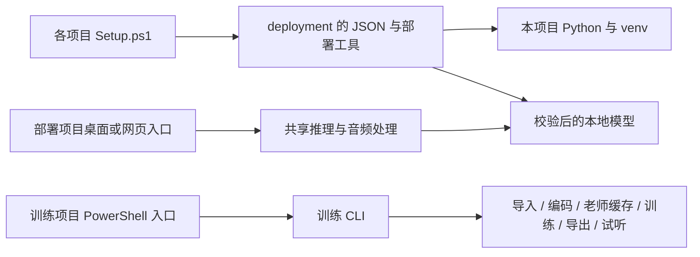

# 声音克隆：部署与角色训练

一个仓库、两个可以单独使用的项目。下载本仓库后，在相应子目录运行 PowerShell 脚本即可；不需要预装 Conda 或 Python。

| 文件夹 | 用途 | 首次部署 | 部署后入口 |
| --- | --- | --- | --- |
| [Qwen_Deployment](Qwen_Deployment/README.md) | 根据参考录音与台词生成声音，提供桌面和网页界面 | `./Setup.ps1` | `./Start.ps1` 或 `./Start-Web.ps1` |
| [Voice_Training](Voice_Training/README.md) | 导入其他角色的录音，训练、导出并试听角色模型 | `./Setup.ps1` | `./New-Character.ps1`、`./Train.ps1` |

## 快速开始

在 Windows PowerShell 中执行：

```powershell
git clone https://github.com/aaf12329/Voince_Clone.git
cd Voince_Clone/Qwen_Deployment
powershell -NoProfile -ExecutionPolicy Bypass -File ./Setup.ps1
powershell -NoProfile -ExecutionPolicy Bypass -File ./Start.ps1
```

训练项目同样先进入 `Voice_Training` 再运行 `Setup.ps1`。一键部署会下载项目自己的 Python、创建 Python 内置的 `.venv`、安装锁定依赖、下载必需模型并检查 GPU。首次部署需要联网和较大的磁盘空间，详见各项目说明。执行策略参数仅对当前进程生效。

## 环境与文件管理

- 面向 Windows x64 和 NVIDIA CUDA 显卡；系统需有兼容 PyTorch CUDA 12.8 的 NVIDIA 驱动。部署检查会报告显卡状态。未验证 CPU、macOS、Linux 的完整运行流程。
- 两个项目各自保存 `runtime/`、`.venv/`、`models/`、`cache/`，不依赖另一个项目，也不引用特定盘符。移动项目后应重新运行部署，重建 `.venv`，因为虚拟环境本身含有生成时的路径。
- `deployment/dependencies.json` 记录 Python、软件包版本及工具下载信息；`deployment/models.json` 记录模型路径、下载地址、大小和 SHA256。GPU 安装包、工具和模型下载后校验；一般 Python 包由包索引按锁定版本安装。
- Git 仅保存代码、公共配置、说明和测试。环境、下载模型、原始录音、角色配置、缓存、训练结果、日志及生成音频均被忽略。训练成果需要另行备份。
- 安装不会自动开始训练；本仓库不包含任何特定角色的私人录音或模型。

## 调用关系



## 验证与范围

部署项目包含音频校验、分段推理、工作进程协议和桌面状态测试；训练项目包含角色隔离、数据重复检查、导出校验和 LoRA 梯度测试。下载器另有本地 HTTP 断点续传与校验测试。

当前角色训练采用 1.7B 老师与 0.6B 学生的 LoRA 蒸馏流程，属于实验训练方案。程序和梯度检查通过不等于任意录音都能得到满意音色；实际效果需要使用独立验证录音和试听评估。

模型与推理接口来自 [Qwen3-TTS 官方项目](https://github.com/QwenLM/Qwen3-TTS)；Python 下载及包安装工具使用 [uv](https://docs.astral.sh/uv/)。模型许可及使用条件以相应上游发布为准。
