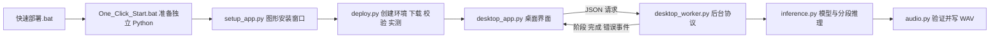

# 声音克隆 · Voice Clone 0.2.0

Windows 本地声音克隆桌面项目，模型为 **Qwen3-TTS-12Hz-1.7B-Base**。获取完整源码后，**双击根目录的 `快速部署.bat`**：自动准备 Python、项目环境、依赖、CUDA 运行库与模型，实际生成测试语音后打开中文桌面窗口。

本 README 是使用、部署、架构、开发与恢复的统一说明。更新日期：2026 年 10 月 9 日。

## 1. 获取后怎么用

1. 从代码仓库 clone 项目，或解压源码包。把项目放在希望长期使用的位置。
2. 双击 **`快速部署.bat`**。初次启动会短暂显示引导窗口，随后进入“安装与启动”窗口。
3. 等待环境、依赖、模型下载与实测完成。首次需要联网；已有完整文件会复用，失败后可重新运行继续。
4. 桌面窗口打开后，选择参考录音，填写录音原文和新的朗读文字，点击“生成语音”。
5. 结果自动写入项目 `outputs/`，可试听、另存为、选择历史结果或打开输出文件夹。
6. 日常仍双击同一个 BAT，或使用自动生成的 **声音克隆_一键版** 快捷方式。

使用解压源码的方式不要求预装 Python、Conda、Git、CUDA Toolkit，也不需要 API Key。使用 `git clone` 则需要已有 Git；它只负责获取代码。

首次模型及语音编码器合计约 4.54 GB；CUDA 版 PyTorch 安装包约 2.86 GB，此外还有 Python、Qt 等依赖。下载时间取决于网络。脚本不检测磁盘容量。

首次部署后不要直接移动整个已安装文件夹：venv 和 Python 运行时包含绝对路径。换位置时从干净源码重新部署，再按需复制自己的 `outputs/`。

## 2. 电脑支持范围

当前支持 **Windows x64 + NVIDIA / CUDA**。没有可用 NVIDIA 显卡或驱动时会给出原因并停止；AMD、Intel 显卡和 CPU 推理暂未接入此部署方案。

**不限定显卡型号，也不设置固定显存、驱动版本或计算能力门槛。**检测 CPU、内存、显卡与驱动后，实际执行 CUDA 运算、加载模型并生成测试语音，按结果判断是否能运行。

- 原生支持 BF16 时用 BF16，否则尝试 FP16。
- 多显卡默认先尝试空闲显存较多的显卡，实测失败后继续其他候选卡。
- 16 GB 系统内存是提醒值，不是安装阻断条件。
- 一次短语音成功不能保证所有文本都成功；使用期间仍可能遇到显存竞争或录音质量问题。
- NVIDIA 驱动使用电脑已有版本，不自动卸载或更新驱动。驱动异常时按报错处理后重试。

CUDA 12.8 运行库由 CUDA 版 PyTorch 提供。本推理项目不需要完整 CUDA Toolkit 或 nvcc。

## 3. 桌面界面

参考录音支持能够被当前音频库解码的 WAV、MP3、FLAC、OGG。建议 5–15 秒、单人说话、少噪声；程序会显示时长、采样率和声道数。损坏、空文件、静音和超出 0.25–120 秒的录音会被拒绝，避免无效输入先占用显卡。

录音原文应逐字匹配录音。需要朗读的文字一次最多 1500 字符。桌面后台会按句子分段，每段不超过约 200 字符，复用参考声音提示，合成为一个 WAV；窗口显示当前段数。较短、完整的句子通常更容易检查生成质量。

“载入官方示例”可直接验证功能。录音文件选择失败时保留上一份有效录音；如果官方示例缺失，重新运行部署入口会恢复它。

生成期间可以取消：程序停止其拥有的推理进程树，并释放模型显存。完成后模型暂时保留，以加快连续生成；**空闲 5 分钟自动释放**，也可以点击“释放显存”。关闭窗口同样停止后台。上次的录音路径与输入保存在本机，重新打开可恢复。

帮助菜单提供统一说明、版本信息和诊断报告导出。报告只包含版本、硬件与部署状态，不包含录音、朗读文字、原始日志或个人文件路径。原始本地日志用于自己排查，分享前自行查看内容。

较小屏幕可滚动窗口内容。播放依赖 Windows 音频设备；如果无法试听，生成文件仍可交给系统播放器打开。文件选择、播放和另存为均使用桌面组件。

## 4. 路径与配置

项目根目录是 `deploy.py` 所在的目录。

| 内容 | 默认位置 |
| --- | --- |
| 虚拟环境 | 项目 `.venv/`，采用 venv + uv，不使用 Conda |
| 独立 Python 3.12.15 | 项目 `runtime/`，不注册为系统 Python |
| 模型及编码器 | 项目 `models/Qwen3-TTS-12Hz-1.7B-Base/` |
| CUDA / PyTorch 实际 DLL | `C:\CUDA\Voice_Clone\runtimes\<项目标识>-torch-2.9.1-cu128\lib` |
| 下载包与 uv 缓存 | `C:\CUDA\Voice_Clone\downloads`、`C:\CUDA\Voice_Clone\cache\uv` |
| 示例与音频工具 | 项目 `samples/`、`tools/sox/` |
| 结果音频 | 项目 `outputs/` |
| 日志、设置与部署状态 | 项目 `logs/` |

项目 `.venv` 内的 `torch/lib` 是指向 C 盘实际运行库的目录链接。不同项目目录使用不同标识，避免相互覆盖 DLL。显式重建环境时为新运行库创建新目录，并保留旧环境及旧库。

`deploy_config.json` 是公开下载配置：主要版本、官方下载 URL、文件大小与 SHA256、模型清单、缓存位置、启动选项。默认没有本机复用路径，不依赖原电脑上的 D 盘安装。

`requirements.lock` 固定经过本次验证的 Python 依赖及间接依赖版本，文件哈希由 JSON 配置校验；PyTorch 与 torchaudio 单独由已校验的官方 CUDA wheel 安装。修改清单后，应同步更新配置哈希并重新验收。

`deploy.local.json` 是可选、仅本机的覆盖配置，不进入 Git 或源码包。只允许覆盖 `cuda_root`、`shortcut_name`、`reuse`。例如希望复用已有下载，可以自行填入对应路径；使用前仍会校验模型和安装包，不按目录名称直接相信文件完整。

```json
{
  "cuda_root": "C:\\CUDA\\Voice_Clone",
  "reuse": {
    "model_directories": [],
    "wheel_directories": [],
    "sox_archives": []
  }
}
```

## 5. 维护与恢复

下列命令在项目根目录运行；平时直接双击 BAT 即可。

```text
快速部署.bat --check-only   读取配置与硬件，不安装推理依赖或下载模型
快速部署.bat --no-launch    部署和验证完成后暂不打开窗口
快速部署.bat --verify       重查依赖、完整模型 SHA256 与实际推理
快速部署.bat --repair       备份旧环境后重建，保留模型、输入与结果
快速部署.bat --diagnostics  导出 logs/diagnostics.json
快速部署.bat --console      使用控制台完成部署与启动，便于查看详细输出
```

BAT 的初次硬件预检仍需准备 uv 与独立 Python。已有 Python 时，可以直接执行 `python deploy.py --check-only`；直接脚本还支持 `--gpu 1` 和 `--config <配置路径>`。

部署中断：重开入口。模型及大型安装包使用 `.part` 续传，完整文件在大小和 SHA256 校验后才正式替换。不完整的项目 venv 会备份后重建；部署锁防止两个安装进程同时修改环境。

环境坏了：先关闭本项目桌面窗口和网页服务，再运行 `--repair`。旧 venv 留在项目 `.venv.backup-<时间>/`，旧 CUDA 库也保留；新环境不删除模型和音频。备份和旧 DLL 可能占用较大空间，在确认新环境可用后自行清理相应备份。

| 现象 | 建议 |
| --- | --- |
| 下载失败或超时 | 检查网络，点击重试或重新运行 BAT；完成文件会复用 |
| 未找到 nvidia-smi / CUDA 不可用 | 核对显卡与驱动；当前后端需要 NVIDIA / CUDA |
| 显存不足 | 关闭其他显卡任务、缩短朗读内容，或指定另一张显卡 |
| 录音不可读 / 静音 | 确认能播放，换为清晰的 WAV、MP3、FLAC、OGG |
| 示例丢失 | 重开部署入口，示例会重新下载并校验 |
| 依赖版本不匹配或运行库丢失 | `--verify` 检查；必要时关闭应用后 `--repair` |
| 窗口启动失败 | 查看 `logs/desktop-launch.log` 和 `logs/desktop-error.log` |
| 生成后台失败 | 查看 `logs/desktop-worker.log`，或先导出诊断报告 |

部署详细记录见 `logs/deploy.log`，硬件见 `logs/hardware-report.json`，模型实测见 `logs/runtime-validation.json`。图形安装窗口失败时自动退回控制台；窗口自身的异常另记为 `logs/setup-window-error.log`。

## 6. 代码结构、架构与语言分工

采用 **桌面界面 + 独立推理进程**。模型在后台进程中按需加载，界面通过标准输入输出的 JSON 行协议发送请求和接收事件。取消和关闭时停止该进程树，避免界面线程执行模型推理。



| 文件 / 模块 | 职责和主要代码 |
| --- | --- |
| `deploy.py` | `load_config()`、`hardware_report()`、`download()` 与 `Deployer`；环境、下载续传、CUDA、模型、修复、快捷方式与启动 |
| `src/setup_app.py` | `parse_progress()`、`main()`；标准库 Tkinter 安装界面，显示阶段、日志、暂停与重试 |
| `src/desktop_app.py` | `VoiceWindow`；输入、试听、历史、状态、取消、显存管理、帮助和单实例窗口 |
| `src/desktop_worker.py` | `event()`、`main()`；解析 JSON 行，调用推理服务并回传事件 |
| `src/voice_clone/inference.py` | `InferenceEngine`、`split_text()`；模型缓存、参考提示复用、分段生成与错误提示 |
| `src/voice_clone/audio.py` | `reference_info()`、`load_reference()`、`write_result()`；输入验证、单声道转换与完整 WAV 发布 |
| `src/voice_clone/project.py` | 项目路径、语言表、目录准备、设置读取和原子 JSON 写入 |
| `src/voice_clone/diagnostics.py` | 按固定允许字段导出诊断，排除用户输入和个人路径 |
| `src/voice_clone/__init__.py` | 应用版本；导入此包不会加载模型 |
| `src/app.py` | 兼容保留的 Gradio 本机网页入口 |
| `scripts/`、`launchers/` | 旧桌面 / 网页辅助入口、环境设置与源码打包工具 |
| `tests/` | 无 GPU 的边界测试与可选的真实 GPU 集成测试 |
| `.github/workflows/checks.yml` | 仓库提交时执行源码测试与源码打包；不要求 CI GPU |

核心与 GUI 都使用 **Python**。日常桌面窗口采用 **PySide6 / Qt**，首次安装窗口采用 Python 自带 **Tkinter**，避免先下载 Qt 才能显示安装状态。**PowerShell / BAT** 只负责 Windows 引导与辅助启动；**QSS** 负责桌面样式；**JSON** 负责下载配置、状态和进程通信。Qt 底层提供窗口与多媒体能力，PyTorch / CUDA 执行显卡计算。

网页入口是兼容功能，保留上传与麦克风录音。`launchers/Start_Voice_Clone.bat` 启动，`Stop_Voice_Clone.bat` 停止，地址为 `http://127.0.0.1:7860`。关闭浏览器不停止模型服务。避免同时打开多份模型服务；主要交付入口为原生桌面。

## 7. 源码发布与 Git

项目已配置 `.gitignore` 和统一换行规则。环境、运行时、模型、音频、缓存、日志、本机覆盖配置、历史备份和发布压缩包均不进入 Git。

别人获取代码后直接运行 `快速部署.bat`。源码仓库只需要这些公开文件，不需要上传本机安装目录。获取代码有两种方式：从你的实际仓库地址 `git clone`，或下载源码发布 ZIP 并解压。本文不预设某个远程仓库地址。

生成源码发布包：

```text
.venv\Scripts\python.exe scripts\package_release.py
```

输出到 `releases/Voice_Clone_0.2.0_源码.zip`。打包工具按允许清单收集源码，校验依赖清单，拒绝携带公开配置中的本机复用路径。ZIP 内附 `RELEASE_MANIFEST.json`，逐文件记录 SHA256；相同源码能重复生成相同压缩包。

**交给别人的是干净源码包或源码仓库。**桌面这份项目可以同时保留自己的已安装环境和生成结果，它们通过忽略规则与发布清单排除，无需先删环境再发布。

## 8. 开发与验收

无需 GPU / 推理依赖的标准库测试：

```text
python -m unittest discover -s tests -p test_deployment.py -v
```

已部署环境中的应用测试：

```text
.venv\Scripts\python.exe -m unittest discover -s tests -p test_application.py -v
```

真实 GPU 集成测试：

```text
.venv\Scripts\python.exe tests\verify_desktop_gpu.py
```

GPU 测试会真实生成短语音，并检查结果、连续生成、取消、关闭与显存释放控制。它使用 Qt 离屏模式，不操作桌面；结果写入 `logs/desktop-controller-validation.json`。普通自动检查不下载模型或加载 GPU。

当前验收覆盖：独立 Python 引导、带空格及中文路径、依赖固定与一致性、模型下载校验、CUDA 和真实短语音、GUI 控制器、错误输入、静音 / 损坏音频、原子设置和 WAV 写入、目录越界、下载续传、服务器忽略续传、错误响应范围、错误 SHA256、模拟多显卡失败切换、修复备份与发布包排除用户数据。

本机实测配置为 i5-14600KF、约 32 GB 内存、RTX 5060 Ti 16 GB。其他显卡通过同样实测流程决定兼容性；多显卡切换已做模拟测试，本机没有物理多卡。自动测试不能判断克隆音色是否符合你的期望，生成结果需要试听确认。人工播放与文件对话框的验收范围见本次本地验收记录。

## 9. 原安装与文档整合

此前安装保存在 `D:\Voice_Clone`，当时 venv 位于 `C:\CUDA\Voice_Clone\.venv`。现在交付源码项目把 venv 放在项目根目录，CUDA 实际库仍默认在 C 盘根目录下；两份代码与环境独立。

当前电脑为了避免重复下载，通过私有 `deploy.local.json` 复用旧模型和部分工具，模型在校验后以目录链接访问。公开源码没有这些 D 盘复用路径；新电脑缺少文件时会自动下载完整模型。旧安装、模型及旧输出不在本次桌面清理范围内。

桌面之前的安装进度 TXT / MD、旧 README 和源码说明已归并到本说明，旧版本与原文保存到项目 `releases/backups/` 作为恢复备份。暂停前无需手工修改环境：下载失败或断电后重新运行部署入口会检查状态并继续。

## 10. 官方来源

模型、参考音频和调用方式来自 [Qwen3-TTS 官方项目](https://github.com/QwenLM/Qwen3-TTS) 与 [ModelScope 模型页面](https://modelscope.cn/models/Qwen/Qwen3-TTS-12Hz-1.7B-Base)。PyTorch / torchaudio 从 [官方 CUDA 12.8 wheel 索引](https://download.pytorch.org/whl/cu128/) 获取；独立 Python 由 [uv 官方管理流程](https://docs.astral.sh/uv/guides/install-python/) 安装；其余依赖按固定版本从 PyPI 获取，SoX 使用其官方项目下载地址。

第三方模型、运行库及界面框架保留各自的许可证与项目说明，源码包不重新打包这些第三方二进制。相关项目说明见 [Qwen](https://github.com/QwenLM/Qwen3-TTS)、[PyTorch](https://github.com/pytorch/pytorch)、[Qt for Python](https://doc.qt.io/qtforpython-6/)、[uv](https://github.com/astral-sh/uv) 和 [SoX](https://sourceforge.net/projects/sox/)。

## 11. 0.2.0 变更

- 新增中文快速部署入口和无需先安装 Qt 的图形安装窗口，支持阶段、日志、暂停与失败重试。
- 公开下载配置与本机覆盖配置分离；增加完整依赖版本清单及其哈希校验。
- 增加保留备份的环境修复、启动诊断与自动恢复缺失示例 / CUDA 链接。
- 拆分路径、音频、推理与诊断模块；输入验证、分段生成、原子音频 / 设置写入和空闲显存释放。
- 增加可重复的源码打包、发布校验清单、Git 忽略规则和源码自动检查流程。
- 旧文档整合为本 README；旧原文及上一个源码包归档备份。

## 12. 本次交付验收记录

2026 年 10 月 9 日，本机完成以下验收：

- 从仅含源码的 ZIP 建立新测试目录，路径包含空格和中文；自动下载独立 Python，建立新 venv，安装 98 个已固定版本的软件包。
- 完整模型与语音编码器从 ModelScope 下载并通过 SHA256 校验，SoX 与官方示例从配置中的公开来源下载；没有借用原 D 盘模型。已有且哈希正确的 C 盘 wheel / uv 缓存按正常规则复用。
- 首次部署实际完成 CUDA 运算、模型加载及短语音生成。
- 新测试项目实际执行了 `--repair --no-launch`：旧环境与旧 CUDA 库保留，创建新环境及新 CUDA 库，再次通过真实推理。
- 新版桌面控制器生成有效音频，手动释放显存、取消生成和生成期间关闭的自动检查通过；本次样例结果为 3.20 秒，生成耗时 16.0 秒。这是本机一次测量，不是其他电脑的速度承诺。
- 快速部署 BAT 实际依次显示“声音克隆 · 安装与启动”和“声音克隆 · Voice Clone”原生窗口。
- 23 项自动检查通过；源码关键错误扫描和 Windows 启动脚本语法检查通过。中文路径 / 旧控制台编码问题已包含回归测试。
- 标准窗口和小窗口已渲染检查；正常尺寸能看到输入、结果与状态，小尺寸保持状态固定可见、内容可滚动。
- 桌面 3 份旧说明与项目内 4 份旧说明已整合；原文逐文件校验后归档到 `releases/backups/文档原文_20261009.zip`，上一个源码包另有备份。

Qt 原生窗口启动与后台控制已验证；真实扬声器声音、人工选择文件 / 另存为对话框及多种音色的主观效果，尚未逐项完成人工验收。网页入口保留兼容能力，0.2.0 的主要验收对象为桌面与一键部署。

本地证据位于 `logs/runtime-validation.json`、`logs/desktop-controller-validation.json`、`logs/native-startup-validation.json`、`logs/desktop-cleanup.json` 和 `logs/release-validation.json`。这些本机记录不会进入源码包。
